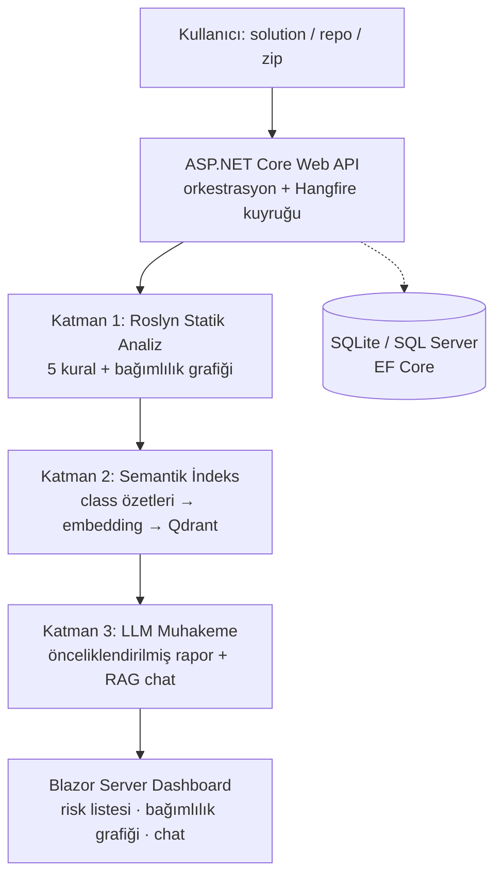

# Legacy Kod Modernizasyon Ajanı

SonarQube ve benzeri araçlar kod tabanını *tarar* ve kural ihlallerini listeler; bu sistem kod tabanını **anlar** ve gerekçeli, önceliklendirilmiş bir modernizasyon planı üretir.

Legacy .NET kod tabanlarında geliştiriciler nereden başlayacağını bilemez: statik analiz araçları yüzlerce uyarı üretir ama hangisinin gerçekten kritik olduğunu söylemez. Bu proje üç katmanlı bir pipeline ile bu sorunu çözer:

1. **Roslyn** — yapısal gerçekler: ne nereye bağlı, hangi pattern'ler kötü kokuyor
2. **Embeddings (Qdrant)** — anlamsal harita: hangi kod parçası hangi kavramla ilgili
3. **LLM (RAG)** — muhakeme: önceliklendirilmiş rapor + kod tabanıyla doğal dilde sohbet

## Mimari



### Analiz kuralları

| Kural | Ne arar | Güven düzeyi |
|---|---|---|
| **NPlusOneQuery** | foreach içinde navigation property üzerinde LINQ çağrısı / iç içe döngü; `.Include()` görülürse bulgu üretilmez, navigation doğrulaması SemanticModel ile yapılır | Orta |
| **GodClass** | 15+ public metod veya 400+ satır; Designer/Migrations/[GeneratedCode] muaf, controller eşiği yükseltilmiş | Orta |
| **LongMethod** | 50+ satır **ve/veya** yüksek cyclomatic complexity — iki metrik birlikte değerlendirilir (uzun ama düz switch → düşük önem; kısa ama iç içe koşullu → bulgu) | Yüksek |
| **CircularDependency** | Tarjan SCC ile class-düzeyi döngüler; katmanlar arası döngü Yüksek, aynı katman içi (ör. Order ↔ OrderLine) Düşük önem | Yüksek |
| **UnusedCode** | `SymbolFinder.FindReferencesAsync` ile 0 referanslı public/internal metodlar; controller action'ları, PageModel handler'ları, interface implementasyonları, virtual/override, test/middleware konvansiyonları muaf | Düşük |

> **Tasarım ilkesi:** Hiçbir statik metrik tek başına "kötü kod" kanıtı değildir. Her bulgu `Confidence` ve `LimitationNote` taşır; sistem "bu kesin hatalı" değil, "bu incelemeye değer, çünkü…" dili kullanır.

## Hızlı Başlangıç

Gereksinimler: .NET 9 SDK. Opsiyonel: Docker (Qdrant), OpenAI/Gemini API anahtarı.

```bash
# 1) API'yi başlat (SQLite şemasını açılışta kendisi kurar)
dotnet run --project src/LegacyModernizationAgent.Api

# 2) Dashboard'u başlat (varsayılan API adresi: http://localhost:5210)
dotnet run --project src/LegacyModernizationAgent.Web

# 3) (Opsiyonel) Semantik katman için Qdrant
docker compose up -d
```

Analizi dashboard'dan ya da API'den başlatın:

```bash
curl -X POST http://localhost:5210/api/analysis \
  -H "Content-Type: application/json" \
  -d '{"source": "C:/repos/EskiProje/EskiProje.sln"}'
```

`source` bir lokal `.sln`/`.csproj`/klasör yolu **veya git URL'i** olabilir; zip için `POST /api/analysis/upload` kullanılır.

### Sadece analiz motoru (API'siz)

```bash
dotnet run --project src/LegacyModernizationAgent.Runner -- <solution.sln> [rapor.json]
```

### LLM / Embedding yapılandırması

`src/LegacyModernizationAgent.Api/appsettings.json` → `Ai` bölümü (veya `Ai__ApiKey` ortam değişkeni):

| Sağlayıcı | BaseUrl | ChatModel | EmbeddingModel | VectorSize |
|---|---|---|---|---|
| OpenAI | `https://api.openai.com/v1` | `gpt-4o-mini` | `text-embedding-3-small` | 1536 |
| Gemini (OpenAI-uyumlu uç) | `https://generativelanguage.googleapis.com/v1beta/openai` | `gemini-2.0-flash` | `text-embedding-004` | 768 |

**Anahtar yoksa sistem çalışmaya devam eder:** rapor kural tabanlı fallback ile üretilir, chat anahtar kelime aramasına düşer — uçtan uca demo API anahtarı gerektirmez.

### Depolama ve güvenlik ayarları

| Ayar | Varsayılan | Açıklama |
|---|---|---|
| `Storage:AllowLocalPaths` | `true` | `false` ise sunucudaki lokal yollar analiz edilemez; yalnızca git URL'i ve zip upload kabul edilir. API başkalarının erişebildiği bir yerde çalışacaksa kapatın. |
| `Storage:CleanupAfterAnalysis` | `true` | Analiz bitince klonlanan repo / açılan zip silinir. |
| `Auth:ApiKey` | boş | Doluysa `/api` altındaki tüm istekler `X-Api-Key` başlığını taşımalıdır. Dashboard için aynı değer Web projesinde `Api:ApiKey` olarak verilir. Anahtarı dosyaya yazmak yerine `Auth__ApiKey` / `Api__ApiKey` ortam değişkenlerini kullanın. |
| `Cors:AllowedOrigins` | `[]` | Tarayıcıdan çapraz köken erişimine izin verilen adresler. Dashboard API'yi sunucu tarafından çağırdığı için boş bırakılabilir. |

> **Bilinen sınırlar:** API anahtarı tek ve paylaşımlıdır (kullanıcı bazlı yetkilendirme yoktur) ve MSBuild, yüklenen projenin build mantığını çalıştırabilir. Sistem lokal/güvenilir ortam için tasarlanmıştır; güvenilmeyen repoları analiz edecekseniz API'yi izole bir konteynerde çalıştırın. Ayrıntı: [docs/architecture.md](docs/architecture.md) Bölüm 11.

## API Uç Noktaları

| Method | Route | Açıklama |
|---|---|---|
| POST | `/api/analysis` | Yeni analiz başlat (lokal yol veya git URL) |
| POST | `/api/analysis/upload` | Zip upload ile analiz başlat |
| GET | `/api/analysis/{id}` | Job durumu |
| GET | `/api/analysis/{id}/findings` | Ham bulgular |
| GET | `/api/analysis/{id}/report` | Önceliklendirilmiş rapor |
| GET | `/api/analysis/{id}/dependencies` | Bağımlılık grafiği verisi |
| POST/GET | `/api/analysis/{id}/chat` | RAG chat / geçmiş |
| GET | `/hangfire` | Job kuyruğu dashboard'u |

## Testler

```bash
dotnet test
```

Her push ve pull request'te GitHub Actions aynı build + test adımlarını çalıştırır (`.github/workflows/ci.yml`).

Analyzer testleri her kural için iki yönü de doğrular: bilinçli kötü kod örneği **yakalanıyor** ve temiz kod **yanlış pozitif üretmiyor**. Kurallar ayrıca gerçek bir açık kaynak projede (eShopOnWeb, 231 sınıf) doğrulandı.

## Proje Yapısı

```
src/
  LegacyModernizationAgent.Analyzer/        Roslyn analiz motoru (yalnızca Microsoft.CodeAnalysis'e bağımlı)
  LegacyModernizationAgent.Core/            Entity'ler + arayüzler (N-Tier çekirdek)
  LegacyModernizationAgent.Application/     Pipeline, rapor/chat/indeksleme servisleri, DTO'lar
  LegacyModernizationAgent.Infrastructure/  EF Core, OpenAI-uyumlu istemciler, Qdrant, Hangfire
  LegacyModernizationAgent.Api/             Web API (giriş noktası)
  LegacyModernizationAgent.Web/             Blazor Server dashboard
  LegacyModernizationAgent.Runner/          Konsol çalıştırıcı (CLI)
tests/
  LegacyModernizationAgent.Analyzer.Tests/  Kural testleri (kritik: yanlış pozitif kontrolü)
  LegacyModernizationAgent.Application.Tests/
docs/
  architecture.md                           Mimari kararlar ve gerekçeleri
```

Mimari kararların gerekçeleri için: [docs/architecture.md](docs/architecture.md)
